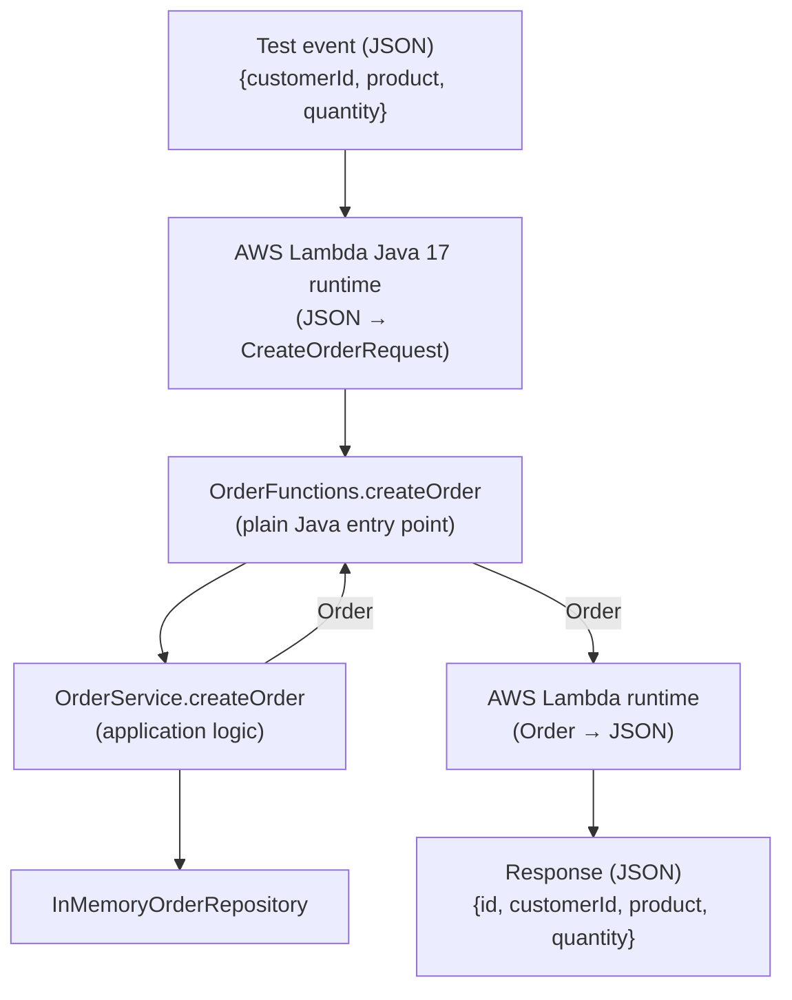
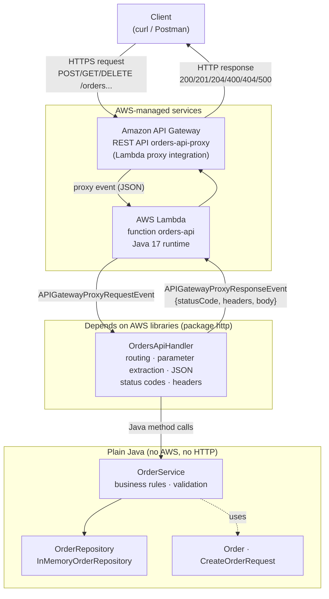

# Designing-a-Serverless-REST-API-with-AWS-Lambda-and-API-Gateway

## API Design

### Order representation
```json
{
  "id": "ORD-001",
  "customerId": "CUST-42",
  "product": "MacBook Air",
  "quantity": 1
}
```

Validation rules:
- `customerId`: required, not blank.
- `product`: required, not blank.
- `quantity`: required, integer ≥ 1.
- `id`: generated by the server; clients do not send it.

### Error format (shared by all operations)
```json
{
  "error": "ORDER_NOT_FOUND",
  "message": "Order ORD-999 does not exist"
}
```

| Error code        | HTTP | When |
|-------------------|------|------|
| `INVALID_REQUEST` | 400  | Missing, blank or invalid data; malformed JSON |
| `ORDER_NOT_FOUND` | 404  | The requested order does not exist |
| `INTERNAL_ERROR`  | 500  | Unexpected failure (stack traces are never exposed) |

### Operations

#### Create an order
| | |
|---|---|
| Method / URL | `POST /orders` |
| Path params | — |
| Query params | — |
| Request body | `{"customerId": "CUST-42", "product": "MacBook Air", "quantity": 1}` |
| Success | `201 Created` + the created order (including its `id`) + header `Location: /orders/{id}` |
| Errors | `400 INVALID_REQUEST`, `500 INTERNAL_ERROR` |

#### Retrieve an order
| | |
|---|---|
| Method / URL | `GET /orders/{id}` |
| Path params | `id`: order identifier (e.g. `ORD-001`) |
| Query params | — |
| Request body | — |
| Success | `200 OK` + the order |
| Errors | `404 ORDER_NOT_FOUND`, `500 INTERNAL_ERROR` |

#### Find orders by customer
| | |
|---|---|
| Method / URL | `GET /orders?customerId={customerId}` |
| Path params | — |
| Query params | `customerId`: required |
| Request body | — |
| Success | `200 OK` + list of orders (may be `[]`) |
| Errors | `400 INVALID_REQUEST` (if `customerId` is missing), `500 INTERNAL_ERROR` |

#### Delete an order
| | |
|---|---|
| Method / URL | `DELETE /orders/{id}` |
| Path params | `id`: order identifier |
| Query params | — |
| Request body | — |
| Success | `204 No Content` (no body) |
| Errors | `404 ORDER_NOT_FOUND`, `500 INTERNAL_ERROR` |

> Note: data is stored in memory. Lambda may recycle its execution environment
> at any time, so this is **not** persistent storage. A few sample orders are
> preloaded so the GET operations can always be tested.

### Design questions

**What are the resources in the API?**
The main resource is the `/orders` collection and each individual order, `/orders/{id}`.
The customer (`customerId`) is an attribute of an order, not a resource of its own in
this version.

**Why `/orders/{id}` to retrieve a particular order?**
In REST, the URI identifies the resource: `/orders` is the collection and
`/orders/{id}` is a specific element of it. The `id` is part of the resource's
identity, so it belongs in the path. The action is expressed by the HTTP method
(`GET`), not by the URL (we avoid `/getOrder?id=...`).

**Why is `customerId` a query parameter?**
It does not identify a resource; it is a **filter criterion** over the `/orders`
collection. Query parameters are the standard mechanism for filtering, searching or
sorting a collection. (`/customers/{id}/orders` would be a valid alternative if
customers were a resource in the system.)

**What should `POST /orders` return when an order is created?**
`201 Created`, the created order in the body (including the generated `id`), and a
`Location: /orders/{id}` header pointing to the new resource.

**What should the API return when an order does not exist?**
`404 Not Found` with a JSON error:
`{"error": "ORDER_NOT_FOUND", "message": "Order ORD-999 does not exist"}`.

**What information should an error response contain?**
A stable, machine-readable error code (`error`) that clients can use in their logic,
and a human-readable `message`. The format must be consistent across the whole API and
come with the correct HTTP status code. It must **never** expose stack traces, secrets
or internal details. As an improvement, it could include a `traceId` to correlate the
error with logs.


## Part I — Plain Java Application

### Checkpoint 1

**Can the application functionality be tested without AWS?**
Yes. `OrderService` is plain Java and is fully tested with JUnit (`mvn test`),
with no AWS account, credentials or network access.

**Does the application require a web server?**
No. There is no Tomcat, Jetty or any HTTP listener; the logic is invoked as
ordinary Java method calls.

**Does it require Spring Boot?**
No. The only dependency is JUnit, and only in test scope.

**What does the generated JAR contain?**
Only our compiled classes (`model`, `repository`, `service`) and the Maven
manifest/metadata. It contains no third-party libraries and no test classes.

**Which parts of the application currently know about HTTP?**
None. Business outcomes are expressed with domain exceptions
(`OrderNotFoundException`, `InvalidOrderException`), not with status codes.
Translating them into HTTP responses will be the responsibility of a later
layer (API Gateway or an HTTP adapter).


## Part II — AWS Lambda

Three Lambda functions were created from the same JAR, each pointing to a
different handler method:

| Function | Handler |
|---|---|
| `orders-create` | `co.edu.escuelaing.orders.lambda.OrderFunctions::createOrder` |
| `orders-get` | `co.edu.escuelaing.orders.lambda.OrderFunctions::getOrder` |
| `orders-search` | `co.edu.escuelaing.orders.lambda.OrderFunctions::findOrdersByCustomer` |

Runtime: Java 17 · Role: `LabRole` · Region: `us-east-1`.
`OrderFunctions` has no AWS dependencies: it is a thin, plain-Java entry point
that delegates to `OrderService`.

### How does the Lambda Java runtime convert JSON ↔ Java?

1. Lambda receives the event as raw JSON bytes.
2. Using reflection, the runtime reads the handler signature (`Class::method`)
   to find the declared parameter type.
3. A built-in JSON serializer deserializes the event into that type, using the
   public no-arg constructor and setters and matching fields by name.
4. The method is invoked, and its return value is serialized back to JSON using
   its getters (a `List<Order>` becomes a JSON array).
5. If the method throws, Lambda returns an error document with `errorMessage`,
   `errorType` and `stackTrace`.

### Checkpoint 2 — Actual solution



### Experiments

Verified against the deployed function (`orders-create`):

| Event | Result | Conclusion |
|---|---|---|
| `{"customerId":"CUST-42","product":"MacBook Air","quantity":1}` | `{"id":"ORD-004",...}` (with *Init duration* ≈ 385 ms) | JSON → `CreateOrderRequest` → `Order` → JSON. First call was a cold start. |
| `{"customerId":"CUST-100","product":"Monitor","quantity":3}` | `{"id":"ORD-004",...}` | The execution environment had been recycled: in-memory data was reset to the sample orders. |
| `{"customerId":"CUST-1","product":"Mouse","quantity":1,"color":"red"}` | `{"id":"ORD-005",...}` | Unknown JSON properties are silently ignored. The environment was warm, so the counter was preserved. |
| `{"customerId":"CUST-42","product":"MacBook Air","quantity":0}` | `errorType: InvalidOrderException`, `errorMessage: "quantity must be..."`, full `stackTrace` | Exceptions thrown by our code become a Lambda error document. The stack trace (`Method.invoke`) confirms the handler is invoked via reflection. It also exposes internals, so it must not reach API clients as-is. |
| `{"customerId":"CUST-1","product":"Mouse","quantity":"two"}` | `errorType: RuntimeException`, `errorMessage: "An error occurred during JSON parsing"`, empty `stackTrace` | Deserialization fails **before** our code runs; our validation is never reached. Type errors and business validation errors are reported differently. |

**Conclusion:** the Lambda Java runtime acts as an automatic JSON adapter. It
deserializes the event into the handler's parameter type by matching property
names (ignoring unknown ones and leaving missing ones as `null`), invokes the
method via reflection, and serializes the return value with its getters.
Errors, whether from our code or from deserialization, are returned as an
`errorMessage` / `errorType` / `stackTrace` document. Because the execution
environment can be recycled at any time, the in-memory repository is not
persistent storage.


## Part III & IV — API Gateway Mapping (Architecture A)

REST API `orders-api-mapping` (Regional), stage `dev`, **non-proxy Lambda
integration**. Each method invokes its own Lambda function; API Gateway
transforms the HTTP request into the JSON expected by the function and
transforms the function's result (or error) into an HTTP response.

Full exported configuration (resources, methods, mapping templates and
selection patterns): [`docs/api-gateway/orders-api-mapping-dev-oas30-apigateway.json`](docs/api-gateway/orders-api-mapping-dev-oas30-apigateway.json)

| Method & resource | Lambda | Request mapping template (`application/json`) |
|---|---|---|
| `GET /orders/{id}` | `orders-get` | `{"id": "$util.escapeJavaScript($input.params('id'))"}` |
| `GET /orders` | `orders-search` | `{"customerId": "$util.escapeJavaScript($input.params('customerId'))"}` |
| `POST /orders` | `orders-create` | `$input.json('$')` (body passed through) |

### Error routing

With non-proxy integration, API Gateway selects the HTTP status by matching a
**regex against the Lambda `errorMessage`**. If no pattern matches, the
*default* response (200) is used, so an unmapped error would reach the client
as `200 OK`. To make routing reliable, `OrderFunctions` translates domain
exceptions into a `FunctionError` whose message starts with a contract error
code:

```
[ORDER_NOT_FOUND] Order ORD-999 does not exist
[INVALID_REQUEST] quantity must be an integer greater than or equal to 1
[INTERNAL_ERROR] Unexpected error
```

`OrderService` remains unaware of this convention.

| Integration response regex | Status | Response mapping |
|---|---|---|
| *(default)* | 200 / 201 | Lambda result passed through (`POST` overrides status to 201 and adds `Location`) |
| `^\[ORDER_NOT_FOUND\].*` | 404 | `{"error": "ORDER_NOT_FOUND", "message": <message without prefix>}` |
| `^\[INVALID_REQUEST\].*\|.*JSON parsing.*` | 400 | `{"error": "INVALID_REQUEST", "message": ...}` |
| `^\[INTERNAL_ERROR\].*` | 500 | `{"error": "INTERNAL_ERROR", "message": "An unexpected error occurred"}` |

The `.*JSON parsing.*` alternative is required because type errors
(`"quantity": "two"`) fail during Lambda deserialization, before our code runs,
so they never carry our prefix.

`POST /orders` default response template:
```
#set($context.responseOverride.status = 201)
#set($context.responseOverride.header.Location = "/orders/$input.path('$.id')")
$input.json('$')
```

Error templates (e.g. 400):
```
#set($raw = $input.path('$.errorMessage'))
#if($raw.startsWith('['))
#set($start = $raw.indexOf(']') + 2)
#set($msg = $raw.substring($start))
#else
#set($msg = "Request body is not valid JSON or has fields with invalid types")
#end
{
  "error": "INVALID_REQUEST",
  "message": "$util.escapeJavaScript($msg)"
}
```

Only `error` and `message` are copied, so Lambda's `stackTrace` is never exposed.

### Example requests and responses

Base URL: `https://rn8nmyawrh.execute-api.us-east-1.amazonaws.com/dev`

| Request | Status | Body |
|---|---|---|
| `GET /orders/ORD-001` | `200 OK` | `{"id":"ORD-001","customerId":"CUST-42","product":"MacBook Air","quantity":1}` |
| `GET /orders/ORD-999` | `404 Not Found` | `{"error":"ORDER_NOT_FOUND","message":"Order ORD-999 does not exist"}` |
| `GET /orders?customerId=CUST-42` | `200 OK` | `[{"id":"ORD-001",...},{"id":"ORD-002",...}]` |
| `GET /orders?customerId=CUST-100` | `200 OK` | `[]` |
| `GET /orders` | `400 Bad Request` | `{"error":"INVALID_REQUEST","message":"customerId is required"}` |
| `POST /orders` ([body](examples/create-order.json)) | `201 Created` + `Location: /orders/ORD-00X` | `{"id":"ORD-00X","customerId":"CUST-42","product":"MacBook Air","quantity":1}` |
| `POST /orders` ([body](examples/create-order-invalid.json)) | `400 Bad Request` | `{"error":"INVALID_REQUEST","message":"quantity must be an integer greater than or equal to 1"}` |
| `POST /orders` ([body](examples/create-order-wrong-type.json)) | `400 Bad Request` | `{"error":"INVALID_REQUEST","message":"Request body is not valid JSON or has fields with invalid types"}` |

```bash
curl -i "https://rn8nmyawrh.execute-api.us-east-1.amazonaws.com/dev/orders/ORD-001"
curl -i -X POST "https://rn8nmyawrh.execute-api.us-east-1.amazonaws.com/dev/orders" \
     -H "Content-Type: application/json" --data-binary "@examples/create-order.json"
```

> Because each method has its own Lambda (and its own memory), an order created
> with `POST /orders` is not visible from `GET /orders/{id}`: only the sample
> orders are shared. This is a direct consequence of non-persistent in-memory storage.

### Checkpoint 3 — What is API Gateway responsible for?

In Architecture A, API Gateway is responsible for:

- **Routing:** mapping `METHOD + path` to a specific Lambda function.
- **Extracting path parameters:** `{id}` via `$input.params('id')`.
- **Extracting query parameters:** `customerId` via `$input.params('customerId')`.
- **Transforming requests:** building the exact JSON each function expects.
- **Transforming responses:** reshaping Lambda errors into the contract's error format.
- **Choosing status codes:** 200 by default, 201 via `responseOverride`, 400/404/500 via selection patterns.
- **Mapping errors:** regex over `errorMessage`, including deserialization errors.
- **Hiding internals:** dropping `stackTrace` and `errorType`.
- **Setting headers:** `Location` on creation.

**Advantages**
- The Java code knows nothing about HTTP: `OrderService` and `OrderFunctions` have no status codes, headers or AWS classes.
- Each Lambda receives a small, purpose-specific input (`{"id": ...}`).
- HTTP behavior (status mapping, response shape) can be changed by redeploying the API, without rebuilding the JAR.
- The HTTP contract is declared explicitly in the gateway (method responses list the allowed status codes).

**Disadvantages**
- **Behavior is split** between Java code and gateway configuration. To understand what `GET /orders` returns, you must read both.
- **Mapping templates (VTL) cannot be tested locally** with `mvn test`. A template bug (arithmetic inside a method argument) was only discovered in AWS.
- **Error routing is string-based:** a regex over `errorMessage`, with one regex per status code. This forced a message-prefix convention (`[CODE]`), so the Java side still has to know a gateway convention; it is coupling, just hidden in strings.
- **Unsafe default:** an error matching no pattern is returned as `200 OK`.
- **Repetitive configuration:** every method repeats method responses, integration responses and templates. With 3 operations this is already about 15 manual console steps.
- **Configuration lives in the console**, not in source control, unless it is explicitly exported (as done here). Manual steps are error-prone; during the workshop a template was accidentally edited on the wrong method.
- **One Lambda per method** means no shared in-memory state between operations.


## Part V — Lambda Proxy Integration (Architecture B)

REST API `orders-api-proxy` (Regional), stage `dev`. All methods use
**Lambda proxy integration** with a **single** Lambda function, `orders-api`
(handler `co.edu.escuelaing.orders.http.OrdersApiHandler::handleRequest`,
Java 17, timeout 10 s).

API Gateway performs no transformation: it forwards the whole HTTP request as
an event and returns whatever status code, headers and body the handler
produces. Exported configuration:
[`docs/api-gateway/orders-api-proxy-dev-oas30-apigateway.json`](docs/api-gateway/orders-api-proxy-dev-oas30-apigateway.json)

### The proxy event

A real event captured from API Gateway (sensitive values redacted):
[`examples/proxy-event-get-orders.json`](examples/proxy-event-get-orders.json)

| Information | Where it appears in the event |
|---|---|
| HTTP method | `httpMethod` (also `requestContext.httpMethod`) |
| Path | `path` = actual path (`/orders/ORD-001`); `resource` = route template (`/orders/{id}`) |
| Path parameters | `pathParameters` (`{"id": "ORD-001"}`), `null` when there are none |
| Query parameters | `queryStringParameters` (`{"customerId": "CUST-42"}`) and `multiValueQueryStringParameters`, `null` when there are none |
| Headers | `headers` and `multiValueHeaders` |
| Request body | `body`, **as a string** (or `null`), with `isBase64Encoded` |

The handler must return
`{"statusCode": ..., "headers": {...}, "body": "<string>"}`, which API Gateway
unwraps into the HTTP response.

> Observed during setup: when a method was accidentally left **without** proxy
> integration, Lambda received an empty event (`No route for null null`) and
> API Gateway returned the handler's whole response object as text with status
> 200. With proxy enabled, the same handler produced the correct status code.

### HTTP adapter

```
API Gateway ──event──▶ OrdersApiHandler ──Java calls──▶ OrderService
                         (AWS + HTTP)                    (plain Java, unchanged)
```

`OrdersApiHandler` is the **only** class that knows about API Gateway events,
status codes, headers and JSON. It:
1. **routes** by `httpMethod` + `resource`;
2. **extracts** `pathParameters`, `queryStringParameters` and parses `body` with Jackson;
3. **calls** `OrderService`;
4. **translates** the outcome: success → 200/201 (+ `Location`) / 204,
   `InvalidOrderException` or malformed JSON → 400,
   `OrderNotFoundException` → 404, anything else → 500 (logged, never exposed).

`OrderService`, the repository and the model were **not modified** to introduce
the proxy architecture. All HTTP behavior is covered by `OrdersApiHandlerTest`
(17 tests, no AWS needed), including the 500 case, which could not be tested
locally in Architecture A.

### Example requests and responses

Base URL: `https://y1r8o51kka.execute-api.us-east-1.amazonaws.com/dev`

| Request | Status | Body |
|---|---|---|
| `GET /orders/ORD-001` | `200 OK` | `{"id":"ORD-001","customerId":"CUST-42","product":"MacBook Air","quantity":1}` |
| `GET /orders/ORD-999` | `404 Not Found` | `{"error":"ORDER_NOT_FOUND","message":"Order ORD-999 does not exist"}` |
| `GET /orders?customerId=CUST-42` | `200 OK` | `[{"id":"ORD-001",...},{"id":"ORD-002",...}]` |
| `GET /orders?customerId=CUST-100` | `200 OK` | `[]` |
| `GET /orders` | `400 Bad Request` | `{"error":"INVALID_REQUEST","message":"customerId is required"}` |
| `POST /orders` ([body](examples/create-order.json)) | `201 Created` + `Location: /orders/ORD-004` | `{"id":"ORD-004","customerId":"CUST-42","product":"MacBook Air","quantity":1}` |
| `POST /orders` ([body](examples/create-order-invalid.json)) | `400 Bad Request` | `{"error":"INVALID_REQUEST","message":"quantity must be an integer greater than or equal to 1"}` |
| `POST /orders` ([body](examples/create-order-wrong-type.json)) | `400 Bad Request` | `{"error":"INVALID_REQUEST","message":"Request body is not valid JSON or has fields with invalid types"}` |
| `GET /orders/ORD-004` (just created) | `200 OK` | `{"id":"ORD-004",...}` |

The last request shows a difference from Architecture A: since all operations
run in the same function, an order created by `POST` is visible to `GET`
while the execution environment stays warm. It is still not persistent.

## Comparing the Two Architectures

| | Architecture A (mapping templates) | Architecture B (proxy + adapter) |
|---|---|---|
| Lambda functions | 3 (one per operation) | 1 (whole API) |
| API Gateway config per method | request template + method responses + integration responses (regex) + response templates | proxy toggle only |
| HTTP logic lives in | API Gateway (VTL, console) | `OrdersApiHandler` (Java, Git) |
| Status codes defined in | method/integration responses, regex, `responseOverride` | `OrdersApiHandler` |
| Locally testable | business logic only | business logic **and** HTTP behavior |
| AWS dependencies in Java | none | only in `http` package |

**Which approach required more API Gateway configuration?**
Architecture A, by far. Each method needed a request mapping template, declared
method responses, one integration response per status code with a regex over
`errorMessage`, and a response template for each one. Architecture B needed only
the resources and the methods with the proxy toggle enabled. The exported
OpenAPI file of B is much shorter than A's.

**Which approach required more Java infrastructure code?**
Architecture B. It needs `OrdersApiHandler` (routing, parameter extraction, JSON
parsing, status codes, headers), `ErrorResponse`, AWS and Jackson dependencies,
and a fat JAR (shade plugin). Architecture A only needed the thin `OrderFunctions`
entry point plus `FunctionError` for the error-prefix convention.

**Which was easier to test locally?**
Architecture B. Its entire HTTP behavior, including 400/404/500, the `Location`
header, malformed JSON and unknown routes, is covered by JUnit tests that build
`APIGatewayProxyRequestEvent` objects by hand. In A, the mapping templates and
regexes could only be tested in AWS; a template error (arithmetic inside a VTL
method call) was only discovered there.

**Where are HTTP status codes defined in each approach?**
- **A:** in API Gateway. Method responses declare them, integration-response
  regexes select them, and `POST` forces 201 through
  `$context.responseOverride.status` in a template. The Java code only emits a
  `[CODE]` prefix that the gateway interprets.
- **B:** in Java, in `OrdersApiHandler.handleRequest` (exception → status) and
  in each operation (`json(201, ...)`, `204` on delete).

**What happens if the API grows from 3 operations to 30?**
- **A:** configuration grows linearly and manually: about 30 request templates and
  over 100 integration responses with regexes and templates. With one Lambda per
  operation, that means 30 functions that share no state, each to deploy. Done in
  the console, this is error-prone (during this workshop a template was edited on
  the wrong method); it would require infrastructure as code (SAM, CDK, Terraform
  or an OpenAPI definition) to stay manageable.
- **B:** API Gateway config stays trivial (or a single `{proxy+}` / `ANY` route),
  but the handler's `if` chain would become a large router. It would need a
  proper routing table or a lightweight framework, or splitting the API into
  several Lambdas per bounded context. Deploying a change to one route
  redeploys the whole function.

**Which approach makes the Java business logic cleaner?**
Neither changes it: `OrderService` is identical in both, which was the goal of
Part I. The difference is the adapter layer. In A the Java entry point is
AWS-free, but it still has to follow a gateway convention hidden in strings (the
`[CODE]` prefix). In B, AWS and HTTP concerns are explicit and confined to one
class (`http` package). B's boundary is more honest; A's Java looks cleaner, but
part of its logic lives elsewhere.

**Which approach would be easier for another developer to understand?**
Architecture B. All the behavior of an endpoint can be read in one place, in
the IDE, under version control, with tests documenting it. In A, understanding
`POST /orders` requires reading Java, a request template, a default response
template with a status override and three regex-selected error templates in the
console (or in a long exported OpenAPI file).

**Which approach would you choose for a larger system? Why?**
Architecture B, with some boundaries. Keep a thin HTTP adapter per service (or
per bounded context, not necessarily one Lambda for everything), define the
gateway with infrastructure as code, and keep business logic in plain Java as
done here. API Gateway should keep the responsibilities it is good at: TLS,
routing, authentication (JWT authorizers), throttling, CORS, logging. Business
decisions and HTTP translation stay in versioned, testable code. This matches the
idea that the gateway protects and routes while services own business decisions.
Architecture A remains useful for small, stable transformations or when
integrating API Gateway directly with AWS services without writing a Lambda.


## Final Challenge — DELETE /orders/{id}

### My prediction (committed before implementation)

- **Which Java classes should change?**

Probably the service, as there's nothing there to allow you to delete currently, and `OrdersApiHandler` and something in the lambda folder depending on the architecture. Also, the exceptions to handle errors when deleting things.

- **Do you need a new Lambda function?**

Yes, in the class `OrderFunctions`, we need to add a method for deletion.

- **Does API Gateway configuration need to change?**

We need to add the DELETE method on the resources part.

- **Where should the deletion logic reside?**

On the service, as that is the responsibility of that class.

- **Where should the decision to return `204` or `404` reside?**

In AWS.

- **Which tests should be added?**

Multiple ones to test different cases when you try to delete things, to prove you can successfully delete, but also what happens when you try to delete something that doesn't exist and so on.

### Agent's proposal vs. my prediction

Implemented in Architecture B only.

| Question | My prediction | Agent's proposal / final implementation | Comparison |
|---|---|---|---|
| Java classes that change | Service, `OrdersApiHandler`, something in `lambda`, new exceptions | `OrderRepository` + `InMemoryOrderRepository` (`deleteById`), `OrderService.deleteOrder`, `OrdersApiHandler` (new route). `OrderNotFoundException` reused; `OrderFunctions` unchanged | I missed the repository layer: deletion also needs a storage operation. No new exception was needed. `lambda` only changes for Architecture A. |
| New Lambda function? | Yes, a method in `OrderFunctions` | No. The single `orders-api` function routes all operations; only the JAR was redeployed | I mixed up a new handler *method* with a new Lambda *function*. In Architecture A it would indeed need a new function. |
| API Gateway changes? | Add a `DELETE` method | Add `DELETE` on `/orders/{id}` (proxy to `orders-api`) and redeploy | Matches. With a `{proxy+}` / `ANY` route it would not be necessary. |
| Deletion logic | `OrderService` | `OrderService` (business rule), delegating removal to the repository | Matches. |
| 204 vs 404 decision | "In AWS" | The **service** decides the outcome (deleted vs. not found); the **HTTP adapter** (`OrdersApiHandler`) translates it to 204/404 | Partially. In B it is Java code running in Lambda, not API Gateway configuration. The business outcome and its HTTP translation are separate responsibilities. |
| Tests | Success, nonexistent order, etc. | Service: delete existing, delete missing, blank id, removed from search. Handler: 204 without body, 404 for missing, 404 on second delete, GET 404 after delete | Matches in spirit; the final tests are more specific. |

**Idempotency:** `DELETE` is idempotent in its *effect*, but our API returns
`204` the first time and `404` afterwards, so clients can tell whether the order
existed. Always returning `204` would be an equally valid choice.

| Request | Status | Body |
|---|---|---|
| `DELETE /orders/ORD-001` | `204 No Content` | *(empty)* |
| `GET /orders/ORD-001` (after delete) | `404 Not Found` | `{"error":"ORDER_NOT_FOUND","message":"Order ORD-001 does not exist"}` |
| `DELETE /orders/ORD-999` | `404 Not Found` | `{"error":"ORDER_NOT_FOUND","message":"Order ORD-999 does not exist"}` |

### Observed while deploying

1. Before the `DELETE` method was available in the deployed stage, API Gateway
   answered `403 {"message":"Missing Authentication Token"}`. That is API
   Gateway's response for an undeclared method/route, and the request never
   reached Lambda. This confirms that the gateway configuration had to change.
2. With the method deployed but the old JAR still in Lambda, the request reached
   `OrdersApiHandler`, which answered `404 ROUTE_NOT_FOUND`. Uploading the new
   JAR fixed it. In Architecture B, a new operation needs **both** a gateway
   route and a code change in the adapter.


## Final Architecture



- **AWS-managed:** API Gateway and the Lambda runtime.
- **Depends on AWS:** only `OrdersApiHandler` (and `ErrorResponse`) in the `http` package.
- **Ordinary Java:** `OrderService`, the repository and the model, fully tested with `mvn test`.

Architecture A (`orders-api-mapping`, mapping templates + `OrderFunctions`) is still
deployed for comparison; see Part III & IV.


## AI-Assisted Development — Criticizing the Agent

I used Claude as an engineering assistant throughout the workshop. These are
non-trivial decisions it made or proposed, and my evaluation of each.

### 1. One Lambda per operation (A) vs. one Lambda for the whole API (B)

- **Decision made by the agent:** In Architecture A, create three functions
  (`orders-create`, `orders-get`, `orders-search`) from the same JAR with
  different handlers. In B, a single `orders-api` function with a router.
- **Why do I think it proposed this?** Non-proxy integration maps each API
  method to one function, and each function can only have one handler method.
  With proxy integration the whole HTTP request arrives, so one function can route.
- **Do I agree?** Partially. It matched each integration style, but in A it
  introduced a real problem: the functions do not share memory, so an order
  created by `POST` could not be read by `GET`. The agent warned about it, but
  it was a direct consequence of its design.
- **Alternative:** In A, a single function receiving an `"action"` field from
  the mapping template; or a real database (DynamoDB) shared by all functions.
- **What I implemented and why:** Both, as proposed: A with three functions to
  show the trade-off, B with one function. For a larger system I would split
  Lambdas by bounded context, not per operation and not one for everything.

### 2. Error routing with a `[CODE]` prefix in the exception message

- **Decision made by the agent:** In A, `OrderFunctions` catches domain
  exceptions and rethrows `FunctionError("[ORDER_NOT_FOUND] ...")`, so API
  Gateway can select the status code with regexes like `^\[ORDER_NOT_FOUND\].*`.
- **Why do I think it proposed this?** API Gateway can only match a regex
  against `errorMessage`; unmatched errors fall back to the default 200 response,
  and a catch-all pattern is unsafe because evaluation order is undefined.
  AWS documents this prefix pattern.
- **Do I agree?** Yes, given the constraint. It is more robust than matching
  free text like `.*does not exist.*`. But it is still string-based coupling:
  the Java side must know a gateway convention.
- **Alternative:** Match the domain messages directly (fragile), or return a
  JSON-encoded error object in `errorMessage` and parse it with `$util.parseJson`.
- **What I implemented and why:** The prefix, translated in `OrderFunctions` and
  not in `OrderService`, so the business logic stayed unaware of API Gateway.

### 3. Validation location: business logic vs. API Gateway

- **Decision made by the agent:** All validation (`customerId`, `product`,
  `quantity`, missing query parameter) lives in `OrderService`. The `customerId`
  query parameter was *not* marked as required in API Gateway.
- **Why do I think it proposed this?** To keep a single, unit-tested source of
  truth and a consistent error format. API Gateway's request validator returns
  its own error body, not our contract's.
- **Do I agree?** Yes. The cost is that invalid requests still invoke Lambda.
- **Alternative:** API Gateway request validators / JSON Schema models, which
  reject bad input at the edge, at the price of a different error format and
  rules that cannot be tested with `mvn test`.
- **What I implemented and why:** Validation in the service, as proposed.
  Type errors in the JSON (`"quantity": "two"`) are the exception: they are
  caught by deserialization (Lambda runtime in A, Jackson in B) before reaching
  the service, and are also mapped to 400.

### 4. Mapping templates proposed by the agent were not always correct

- **Decision made by the agent:** It wrote the 404 response template using
  `$raw.substring($raw.indexOf(']') + 2)`. Later, it worked around a console
  limitation by forcing `201` with `$context.responseOverride.status` inside a template.
- **Why do I think it proposed this?** It reasoned as if VTL behaved like Java;
  it does not allow arithmetic inside method arguments.
- **Do I agree?** No for the first one: the template failed in AWS with a
  generic `500 Internal server error`, and it was only fixed (computing the
  index first with `#set`) after testing. The second one works, but it hides
  the status code inside a template instead of the visible method configuration.
- **Alternative:** Architecture B, where the same logic is Java and is tested
  locally; in that case the error would have been caught by `mvn test`.
- **What I implemented and why:** The corrected template and the
  `responseOverride`. This experience is one of the strongest arguments in my
  comparison: VTL logic cannot be tested locally, and errors only appear once deployed.

### 5. `DELETE` on a missing order returns 404 (not 204)

- **Decision made by the agent:** The second `DELETE` of the same order returns `404`.
- **Why do I think it proposed this?** To let clients know whether the
  resource existed, reusing `OrderNotFoundException`.
- **Do I agree?** Yes, and it is still idempotent in effect: the server state
  after one or many calls is the same.
- **Alternative:** Always return `204`, which is simpler for clients that
  retry and do not care whether the order existed.
- **What I implemented and why:** `404`, consistent with `GET` of a missing order.


## Build & Test Instructions

**Prerequisites:** JDK 17+ (built with `release 17`), Maven 3.8+, Git.

```bash
mvn test       # runs all unit tests (no AWS needed)
mvn package    # builds target/orders-api-1.0-SNAPSHOT.jar (fat JAR via shade)
```

**Deploy (summary):**
1. Create Lambda functions (Java 17, role `LabRole`) and upload the JAR:
    - Architecture A: `orders-create`, `orders-get`, `orders-search` with handlers
      `co.edu.escuelaing.orders.lambda.OrderFunctions::createOrder | ::getOrder | ::findOrdersByCustomer`.
    - Architecture B: `orders-api` with handler
      `co.edu.escuelaing.orders.http.OrdersApiHandler::handleRequest` (timeout 10 s).
2. Import the API definitions from `docs/api-gateway/` (API Gateway →
   Create API → REST API → Import), or recreate them as described in
   Part III & IV and Part V. Then deploy to stage `dev`.
3. Test with the `curl` commands in this README and the bodies in `examples/`.

**Clean up:** delete both REST APIs, the four Lambda functions and their
CloudWatch log groups (`/aws/lambda/orders-*`).
